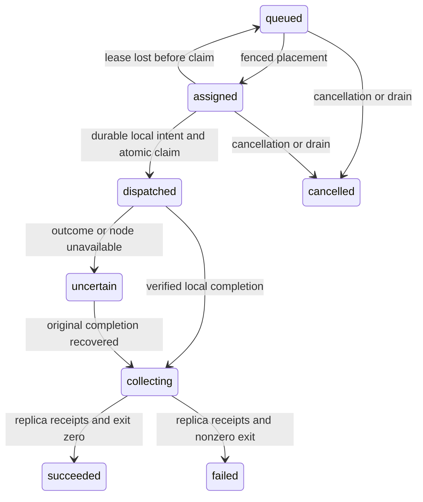

# M5: Multi-server scheduling, ownership and failover

M5 adds a shared control plane above M4.4. Each worker server runs its own
E2B/Embed backend, private M4.4 fleet daemon, node intent journal and artifact
replica store. Two coordinators share a three-member etcd quorum. Only the
elected coordinator places jobs; accepted requests survive coordinator restarts.

## What is implemented

| Capability | Behavior |
| --- | --- |
| Placement | Least allocated eligible node; exact VM shape, labels, node CPU/RAM and global tenant budgets checked atomically |
| Admission | Durable async acceptance, identical ID replay, changed request conflict, bounded queue |
| Ownership | Stable node incarnation, monotonically increasing placement epoch, server-managed node and coordinator leases |
| Coordinator failover | A standby acquires the expired leader key; every placement and replica publication compares its unique leader token |
| Pending failover | Assignments that have never crossed the durable dispatch point return to the queue and may move |
| Dispatched node loss | State becomes `uncertain`; original owner, execution ID and reservations remain pinned |
| Local crash safety | Fsynced outbox before distributed claim and before each VM/job admission RPC; a missing response never authorizes resend |
| Result durability | Completion is published only after verified bundles are fsynced on the configured number of distinct nodes; default two |
| Artifact failover | Downloads validate the original identity and hashes; a surviving recorded replica serves results after owner loss |
| Replica repair | Coordinator copies a surviving verified bundle to another healthy node when the live replica count falls below target |
| Maintenance | Durable node drain stops new placement; cluster drain closes admission and cancels never-dispatched jobs |
| Transport | TLS 1.3 mutual authentication, separate etcd/API CAs, API certificate roles; no public plaintext control API |
| Shutdown | Stopping coordinators/agents does not delete VMs or discard reservations |

This is bounded, trusted-host orchestration: at most 16 registered nodes, 128
historical jobs per namespace, eight declared artifacts per job, 1 MiB per
artifact, command timeout 1–60 seconds. Defaults allow alpha/beta eight logical
jobs each and eight CPU / 8192 MiB active resources per tenant across the
cluster. Policies are immutable for a namespace. This milestone does not add
an LLM reasoning loop, public tenant authentication, indefinite job retention,
VM migration, or replay of uncertain side effects.

## Safety model



The claim is deliberately conservative: a crash immediately after claiming
but before sending a command still pins the job. Availability is sacrificed
when execution cannot be proved absent. The storage gate serializes admission,
placement, worker reports and cancellation. Node lease deletion never proves
VM deletion; only the original fleet journal's confirmed `deleted` state
releases its reservation. Lost quorum prevents new dispatch claims and metadata
publication. Already claimed commands may continue on their original worker.

Metadata includes command bytes while queued and until local acceptance;
API responses and logs redact them. etcd's WAL, snapshots and backups can retain
old bytes. Do not put credentials in commands. Result bodies and artifact bytes
are held on worker disks, not inside etcd. Evidence hashes bind observed bytes;
they are not an attestation against a malicious worker or proof of arbitrary
external effects. Host agents and coordinators are trusted control-plane actors.

## One complete release gate

Run this on the existing Linux E2B server. It uses the existing passwordless
`sudo -n docker` route, never changes sudoers/groups/passwords, never installs a
service, and never needs `runsc`. It pulls pinned official etcd **v3.7.4** and
creates three isolated, named containers on loopback with private bind-mounted
data directories. Existing E2B services and previous journals are preserved.

```bash
cd ~/src/agent-runtime-lab
git fetch origin feat/m5-multi-server
git switch feat/m5-multi-server
git pull --ff-only origin feat/m5-multi-server

sdk_env="$(sudo -n docker compose --project-directory "$HOME/e2b" exec -T ready cat /run/e2b/sdk.env)" || exit 1
eval "$sdk_env"
unset sdk_env
test -n "${E2B_API_KEY:-}" || { echo 'E2B_API_KEY is missing'; exit 1; }
export E2B_API_KEY
export E2B_API_URL="${E2B_API_URL:-http://127.0.0.1:3000}"
export E2B_EXEC_PROXY="${E2B_EXEC_PROXY:-http://127.0.0.1:3002}"

./scripts/verify.sh cluster
```

The gate runs formatting, vet and all race tests, M4.3/M4.4 live regression
checks, real etcd quorum/lease tests, then the full M5 live scenario. It starts
three fleet daemons, three node agents and two coordinators automatically. It
kills a worker before claim, kills the coordinator, forces an actual fleetd
exit 87 after durable artifacts, verifies the dispatched job stays pinned,
recovers only original evidence, and downloads from a surviving replica after
the original node is stopped. An append-only marker must remain one line.

Cleanup stops only the processes/containers created by the gate and uses the
existing selected-journal cleanup engine to confirm VM deletion. Journals,
certificates, archives, etcd data, cleanup reports and logs remain in private
`.state/m5-*` and `.state/verify-*` directories. Failure to clean up fails the
test and retains reservations. Never delete those directories to clear an error.
An interrupted verification can leave resources: use each printed fleet
journal with the standalone cleanup command below. A hard host failure also
requires reviewing test container names before deleting selected containers.

For a quorum/transport gate without E2B credentials:

```bash
cd ~/src/agent-runtime-lab
./scripts/verify.sh quorum
```

CI runs that quorum gate against real etcd, plus a TLS node/coordinator protocol
test with a synthetic fleet backend. That test exercises async admission,
artifact replication, reservation release, coordinator replacement and download
after owner loss; it makes no live VM execution claim. The full live gate is
opt-in and must pass on the E2B host before calling
M5 live-verified. A single-host process test does not prove physical host HA.

## Build and operator commands

```bash
cd ~/src/agent-runtime-lab
source ./scripts/env.sh
mkdir -p bin
go build -o bin/lab-clusterd ./cmd/lab-clusterd
go build -o bin/lab-node-agent ./cmd/lab-node-agent
go build -o bin/lab-clusterctl ./cmd/lab-clusterctl
go build -o bin/lab-cluster-pki ./cmd/lab-cluster-pki
go build -o bin/e2b-fleetd ./cmd/e2b-fleetd
go build -o bin/e2b-fleet-cleanup ./cmd/e2b-fleet-cleanup
CGO_ENABLED=0 GOOS=linux GOARCH=amd64 go build -trimpath -o bin/e2b-task-agent ./cmd/e2b-task-agent
```

For an already running deployment, configure `M5_SERVERS` with the coordinator
origins and `M5_PKI` with the operator certificate directory. Every CLI mutation
uses its first origin once. After an ambiguous response inspect by job ID. GET
operations may fall back to the next origin. Switch the first origin to the
surviving coordinator before a subsequent explicit mutation.

```bash
cd ~/src/agent-runtime-lab
export M5_SERVERS=https://127.0.0.1:7443,https://127.0.0.1:7444
export M5_PKI="$HOME/src/agent-runtime-lab/.state/m5-pki"

./bin/lab-clusterctl --servers "$M5_SERVERS" --pki "$M5_PKI" cluster-status
./bin/lab-clusterctl --servers "$M5_SERVERS" --pki "$M5_PKI" --execute \
  --id demo-once --tenant alpha --cpu 2 --memory-mib 2048 --timeout 30 \
  --artifact /tmp/demo-once.txt \
  --command 'echo marker >> /tmp/demo-once.txt; wc -l /tmp/demo-once.txt' submit
./bin/lab-clusterctl --servers "$M5_SERVERS" --pki "$M5_PKI" --id demo-once --wait-timeout 5m wait
./bin/lab-clusterctl --servers "$M5_SERVERS" --pki "$M5_PKI" --id demo-once result
./bin/lab-clusterctl --servers "$M5_SERVERS" --pki "$M5_PKI" --id demo-once --index 0 --output ./demo-once.txt download
./bin/lab-clusterctl --servers "$M5_SERVERS" --pki "$M5_PKI" list
```

`download` refuses to overwrite a file and verifies its checksum before an
fsynced atomic publication. A nonzero command exit publishes `failed` with its
verified result. `wait` exits nonzero for failed/cancelled/uncertain outcomes.

```bash
cd ~/src/agent-runtime-lab
./bin/lab-clusterctl --servers "$M5_SERVERS" --pki "$M5_PKI" --id demo-once status
./bin/lab-clusterctl --servers "$M5_SERVERS" --pki "$M5_PKI" --execute --id demo-once recover
./bin/lab-clusterctl --servers "$M5_SERVERS" --pki "$M5_PKI" --execute --id queued-job cancel
./bin/lab-clusterctl --servers "$M5_SERVERS" --pki "$M5_PKI" --execute --id node-a node-drain
./bin/lab-clusterctl --servers "$M5_SERVERS" --pki "$M5_PKI" --execute drain
./bin/lab-clusterctl --servers "$M5_SERVERS" --pki "$M5_PKI" cluster-status
```

Drain is durable across restarts. It does not claim an uncertain command was
cancelled or delete an unknown VM. Recover contacts only the original node;
the original node's M4.4 recovery path inspects persisted completion evidence.
No recovery command executes a shell command again.

## Deploying across physical servers

Use three independent worker failure domains if new jobs must still obtain
two artifact receipts after losing one server. Run three etcd voting members
on independent disks/hosts and at least two coordinators. Bind private network
addresses, firewall etcd/API ports to control-plane peers, and issue certificates
with those exact SANs. Do not advertise loopback between physical servers.
Do not place two node IDs on the same underlying fleet journal or backend
capacity budget: cluster scheduling assumes those budgets are independent.

Each node uses a dedicated fleet journal/socket and an independent local E2B
backend. Keep its `--host-cpu` / `--host-mib` within that server's actual budget.
Node agent `--labels region=blr,pool=agents` and job `--labels pool=agents`
constrain placement. Artifact replicas count distinct node identities, not
automatically detected racks or zones; operators must map those identities to
independent failure domains. A job remains `collecting` if fewer than two
healthy archive nodes can acknowledge its bundle.

The PKI utility creates development certificates valid for one year and refuses
to overwrite existing files. It does not retain CA signing keys and is not a
production certificate rotation service. Production should use an existing CA
and per-host leaf keys with CN roles `coordinator`, `node`, `operator` and
appropriate server SANs. API and etcd must use different trust roots. etcd
uses transport mTLS; this implementation does not claim etcd CN-based RBAC.
Distribute only each process's needed leaf key, CA and etcd client credentials;
never copy the entire development PKI directory into a workload VM.

| Process | Required API files | Additional etcd files |
| --- | --- | --- |
| Coordinator | cluster-ca.pem, coordinator.pem, coordinator.key | etcd-ca.pem, etcd-client.pem, etcd-client.key |
| Node agent | cluster-ca.pem, node.pem, node.key | etcd-ca.pem, etcd-client.pem, etcd-client.key |
| Operator CLI | cluster-ca.pem, operator.pem, operator.key | none |
| etcd server | none | etcd-ca.pem, etcd-server.pem/key, etcd-peer.pem/key |

Keep node journal/lock, fleet journal/task journal and both artifact stores on
durable local disks. Restart an existing node with **the same** state files and
node ID. A replacement disk gets a **new node ID**; it cannot adopt outstanding
jobs from the old incarnation. A permanently lost dispatched owner requires
human side-effect reconciliation; the scheduler offers no force-replay switch.

Keep etcd snapshots and archive backups separately. Before restoring etcd to an
older revision, fence/stop every old coordinator and node agent: restoring a
snapshot without fencing old processes can resurrect historical dispatch
intent. Do not use `--force-new-cluster` while old members/clients remain live.
Restore all related node/fleet journals consistently or use a new namespace
and treat unresolved old work as reserved until independently reconciled.

## Cleanup after a stopped daemon

After stopping the corresponding node agent and fleetd, select its exact
journal using `M5_FLEET_JOURNAL`. This works without a running Unix socket and
does not delete other fleets or remove the saved journals.

```bash
cd ~/src/agent-runtime-lab
test -n "${M5_FLEET_JOURNAL:-}" || { echo 'Set M5_FLEET_JOURNAL to the exact printed fleet.json path first'; exit 1; }
./bin/e2b-fleet-cleanup --execute --state-file "$M5_FLEET_JOURNAL" --timeout 120s
```

After offline cleanup, restart the same node agent/fleetd briefly if the cluster
needs its reservation-release acknowledgement. Do not clear global records
based only on an offline node or expired lease. There is no automatic garbage
collection of historical jobs or archives in this milestone; quota exhaustion
fails closed and requires planned namespace retirement after full cleanup.

## Maintainer verification record

The full Go race/format/vet gate, inventory audit gate, and real three-member
etcd/TLS protocol gate passed in PR #15 on commit
`086eb84b1a3c68034fbfcbc1ce1702590197ecad`. The quorum gate includes
server-side lease expiration, stale coordinator rejection, operation with one
member down, fail-closed behavior with two members down, and verified replica
access after owner loss. Those CI tests do not include real E2B commands.
After fixture fix `8ff1be38e0203fc44982d9962fe16daeb80cad6a`, the operator
reported the complete live cluster gate passed on 2026-11-25. This is an
operator-confirmed single-host process-failover pass; the successful run's raw
logs were not supplied for independent review. Physical multi-server failure
validation remains separate. See verification-status.md for the failure,
fix and successful rerun record.

References: [etcd JSON gateway](https://etcd.io/docs/v3.6/dev-guide/api_grpc_gateway/),
[client design and failure semantics](https://etcd.io/docs/v3.6/learning/design-client/),
[v3.7.4 release and official container](https://github.com/etcd-io/etcd/releases/tag/v3.7.4).
